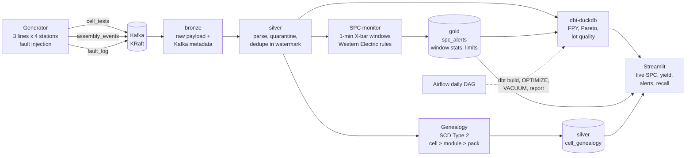

# CellTrace

Streaming quality and traceability pipeline for battery cell manufacturing:
Kafka, Spark Structured Streaming, Delta Lake, dbt, Airflow and Streamlit, all running locally in Docker.

Every battery cell gets an end-of-line test (open-circuit voltage, internal resistance,
capacity, temperature) before it is welded into a module and the module into a pack. Two
things go wrong in practice. A test station drifts slowly, so readings creep for hours
before anyone notices, and good cells get scrapped or bad ones shipped. Or a raw-material
lot turns out to be weak, and the plant has to find every pack that contains a cell from
that lot, including cells that were reworked into a different module along the way.
CellTrace simulates 12 end-of-line stations, catches station drift with statistical process
control (SPC) within minutes, and answers "which packs contain lot X" in milliseconds from
a cell, module and pack genealogy that keeps its full history.

## Architecture



All Spark streaming stages run in one driver (`streaming/run_all.py`). Every Delta table
lives under one lakehouse root: bronze, silver and gold for the streams, `gold/dbt` for
the dbt marts (Parquet).

## Quickstart

Needs Docker Desktop and GNU make. Everything else runs in containers.

```bash
make build
```

```bash
make pipeline
```

```bash
make dashboard
```

`make pipeline` starts Kafka, creates the topics, and runs the generator and all
streaming stages. Open the dashboard at http://localhost:8501. The SPC baseline takes 5
minutes, the bad lot appears around minute 7, and station L2-S3 starts drifting at minute 10.

Other entry points:

| Command | What it does |
|---|---|
| `make dbt` | Build and test the dbt models, generate docs |
| `make airflow` then `make airflow-trigger` | Start Airflow (http://localhost:8081, admin/admin) and run the daily DAG |
| `make inspect` | Row counts, duplicate check and quarantine reasons per table |
| `make recall ARGS="--bad-lot"` | Recall lookup for the lot the generator degraded |
| `docker compose run --rm app python -m scripts.detection` | Time-to-detect and false alarm summary |
| `make test` | Full pytest suite in the app container |
| `make reset` | Delete Kafka data and the whole lakehouse |
| `docker compose run --rm app python -m scripts.seed_lakehouse` | Build a lakehouse in seconds without Kafka or Spark |

Kafka UI is at http://localhost:8085 and the Spark UI at http://localhost:4045.

## What each stage does

The generator (`generator/`) is a seeded, pure-Python simulation of 3 production lines with
4 test stations each, publishing JSON at a configurable rate (default 50 cells per second).
Readings follow normal distributions around a 3.65 V, 1.20 mOhm, 5.0 Ah cell, and PASS/FAIL
comes from the spec limits in `dbt/seeds/spec_limits.csv`. Passing cells fill modules of 46 and
packs of 4 modules per line. It injects five kinds of trouble: an IR ramp on one station, a
lot with lower capacity, sensor dropouts (nulls or stuck-at-zero), late events and duplicates,
plus occasional rework that moves a cell to another module. Each injected fault is written to
a `fault_log` topic so detection can be scored.

Bronze (`streaming/bronze_ingest.py`) lands raw Kafka records with topic, partition, offset
and ingest time. Silver (`streaming/silver_transform.py`) parses against explicit schemas,
quarantines bad rows with every reason that applies, drops duplicate `event_id`s within a
10-minute watermark, and asserts data quality on each micro-batch before an idempotent append.

The SPC monitor (`streaming/spc_monitor.py`, rules in `streaming/spc_rules.py`) builds an
X-bar chart for every station and metric from 1-minute windows. The first 5 windows set the
limits, then each window is scored and checked against the four Western Electric rules.

Genealogy (`streaming/genealogy.py`, rules in `streaming/genealogy_rules.py`) keeps
`silver.cell_genealogy` as SCD Type 2. Rework closes a version and opens a new one. A pack
assignment fills `pack_id` on the open version instead, because the cell did not move.

dbt (`dbt/`) builds first-pass yield, a defect Pareto, lot quality with an outlier flag,
station and lot dimensions, and a daily report, with 46 data tests. The Airflow DAG
(`airflow/dags/celltrace_daily.py`) runs dbt, compacts and vacuums silver, and publishes the
daily report to `gold.daily_quality_report`.

## Results

Measured on a laptop (8 cores, 16 GB, Docker Desktop on Windows), one 20-minute run at the
default 50 cells per second, then a throughput burst.

| Measure | Result |
|---|---|
| Station drift (IR +0.25 mOhm ramped over 10 min) | First alert (WE1) 195 s after onset: 98 s of event time plus pipeline latency |
| Drift size when caught | 0.041 mOhm, 3.4% of nominal IR |
| Bad lot (capacity -0.12 Ah) | First alert 155 s after the lot's first cell (58 s event time); dbt flags it at z = -168 |
| Recall lookup | Bad lot traced to 17 packs, 56 modules and 2,415 cells in 340 ms (670 ms before OPTIMIZE) |
| Data correctness | Every bronze event lands in silver or quarantine exactly once; 609 duplicates (1.0%) removed |
| Sustained throughput | About 736 messages/s (about 400 cells/s) end to end, 7x the default rate |
| Unexplained alerts | 18 alert episodes on 13 of 36 series in 15 monitored minutes (see below) |
| Tests | 84 pytest tests (unit, Spark streaming, DuckDB, dashboard), 4 Airflow DAG tests, 46 dbt data tests |

Wall-clock time-to-detect adds about 97 seconds to the statistics: the 1-minute window, the
1-minute watermark that waits for late events, and three 10-second trigger hops from Kafka
to bronze to silver to SPC.

Throughput was measured with a 2-minute burst at 1,000 cells/s (1,768 messages/s produced).
Silver held every message 189 s after the producer stopped. Per-batch timing logs show the
limit is fixed cost per micro-batch (state store and Delta commits across 13 concurrent
queries on 8 cores), not data volume: a sink takes 20 to 40 s for 500 rows or 35,000 rows
alike. Longer triggers trade latency for throughput.

The unexplained alerts come from the short SPC baseline. Five 1-minute windows estimate each
center line from about 1,250 cells, which leaves it uncertain by about 0.45 sigma of a
window mean, and the side-of-center rules (WE3, WE4) then fire on series that are in
control. A 20-window baseline would fix it at the cost of a 20-minute warm-up before any
fault; `SPC_BASELINE_WINDOWS` makes that a one-line change.

## Design decisions

The full log with reasons is in [DECISIONS.md](DECISIONS.md). The ones that shaped the code:

- Domain logic is plain Python. The simulator, the SPC rules, the SCD2 versioning and the
  quarantine rules have no Spark import, so most of the test suite runs in seconds without a
  broker or JVM. Spark and Kafka code is a thin shell around them.
- One spec table. The generator and dbt read the same `spec_limits.csv`, so a station's PASS
  and dbt's failure cause can never disagree.
- Idempotent sinks. Every `foreachBatch` append uses Delta's `txnAppId`/`txnVersion`, alert IDs
  are deterministic, and genealogy is a MERGE on its SCD2 key, so a replayed micro-batch after
  a crash changes nothing.
- Two-condition lot outliers. A lot is flagged only when its z-score is large and the shift is
  at least half a within-lot standard deviation. A pure z-score flags the lots tested during the
  station drift, which is a station problem, not a lot problem.
- Faults start after the SPC baseline, so they cannot contaminate the limits they should trip.

## Tests

```bash
make test
```

Pure tests also run on the host (`pytest -m "not spark"`). Spark streaming tests drive the real
queries with `availableNow` triggers over a temporary lakehouse. CI (`.github/workflows/ci.yml`)
runs the whole suite on Ubuntu, seeds a lakehouse with `scripts/seed_lakehouse.py`, runs
`dbt build` against it, and tests the DAG against Airflow 2.10.5.

## What I'd do at production scale

- Exactly-once end to end. Bronze is effectively exactly-once through Spark checkpoints and
  Delta commits, and the silver and gold sinks are idempotent. In production I'd add a
  transactional or idempotent producer contract per station, use Kafka transactions for any
  Kafka-to-Kafka hop, and alert on consumer lag.
- A schema registry. Payloads would be Avro or Protobuf with compatibility rules enforced at
  produce time, so a firmware update on a test station cannot silently break silver parsing.
- Unity Catalog (or another catalog) instead of path-based tables: table-level permissions,
  lineage from bronze to dashboard, and audit of who ran a recall query.
- Partitioning and clustering. Silver partitioned by test date and clustered by line and
  station; genealogy clustered by `cell_id` and `lot_id` so recall stays a point lookup at
  billions of cells.
- Per-station SPC with longer baselines (20 to 25 subgroups), rational subgrouping by shift,
  and EWMA or CUSUM charts for slow drifts that Western Electric rules catch late.
- Separate compute for streaming and batch, with OPTIMIZE and VACUUM on a schedule tuned to
  the streams' checkpoint retention.

## Layout

```
config/            settings from .env, spec limits and plausibility ranges
generator/         simulator (pure) and Kafka producer
streaming/         bronze, silver, SPC and genealogy streams plus their pure rule modules
scripts/           inspect, detection, recall lookup, dbt runner, Delta maintenance, seeder
dbt/               dbt-duckdb project: staging views, Parquet marts, tests, spec seed
airflow/dags/      celltrace_daily DAG
dashboard/         Streamlit app, queries and Plotly charts
tests/             pytest suite mirroring the packages above
docker/            app and Airflow images
```
